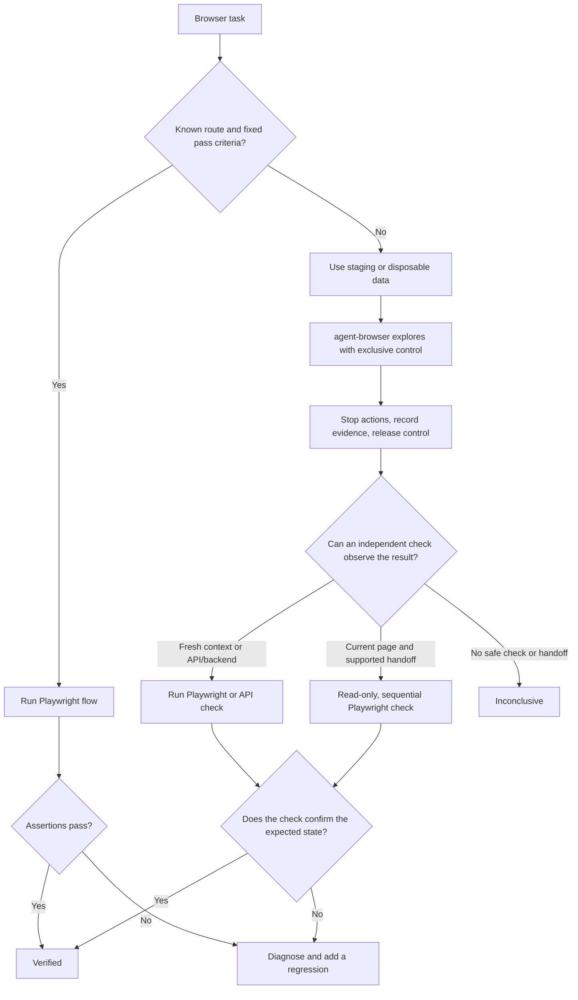

# agent-browser-playwright

Help Codex explore unfamiliar websites and verify what happened—without two tools controlling the same browser at once.

[](#status) [](#status) [](LICENSE)

## Status

Experimental. Developed and tested under Codex only; other agent hosts have not been validated.

## Install in Codex

> **Choose one option to install the skill:**

### Option 1: Install the skill directly

In Codex, use `$skill-installer` and provide the [skill folder on GitHub](https://github.com/katniis/agent-browser-playwright/tree/main/skills/agent-browser-playwright).

### Option 2: Install it as a plugin

1. Add this repository's marketplace:

   ```bash
   codex plugin marketplace add katniis/agent-browser-playwright
   ```

2. In Codex, open the Plugins Directory, choose this marketplace, and install `agent-browser-playwright`. If it does not appear, restart Codex and check again.

> **Tools needed:** For the combined workflow, install [Vercel Labs' agent-browser](https://github.com/vercel-labs/agent-browser), [Microsoft Playwright](https://github.com/microsoft/playwright), and their browser runtimes separately. This repository contains the skill instructions only. Known, repeatable flows can use Playwright alone.

After installing the skill, ask Codex: “Use `agent-browser-playwright` to handle this browser task and verify the result.”

## How it works

Use Playwright for a known flow with clear pass criteria. Use agent-browser to explore an unfamiliar goal in staging or with disposable data. Then verify the result with an independent Playwright check or an API/backend check.



Let one tool finish and release control before the other acts. A screenshot or an agent's “done” message is useful evidence, but does not prove the task passed. Report success only when the declared check succeeds; if nothing can safely observe the result, report it as inconclusive.

## What each tool can do

- **agent-browser CLI:** explore pages, fill forms, use tabs, inspect accessibility snapshots and element references, capture screenshots, check console and network activity, and route requests or export HAR files.
- **Playwright Test/library:** repeat actions using locators and auto-waiting, assert results, isolate browser contexts, mock APIs, and capture traces for debugging.
- **Playwright MCP:** let Codex navigate and inspect a browser through tools exposed by its MCP configuration. Available tools vary by setup; MCP calls alone do not create a reusable Playwright Test suite.

## Safety

- Before first use or after an agent-browser CLI version change, read its instructions with `agent-browser skills get core`.
- Domain and action restrictions are opt-in. Confirm they are active before navigation. The domain allowlist limits browser requests; it is not a system-level network firewall.
- Explore unfamiliar tasks in staging or with disposable data. Stop agent-browser actions before verification, save the goal, app/build, final URL, status, relevant evidence, and errors, and redact secrets or sensitive data.

## Contributing

For workflow changes, include the task type, expected check, and evidence that browser control stays exclusive and results are independently verified.

## License

[MIT](LICENSE)
