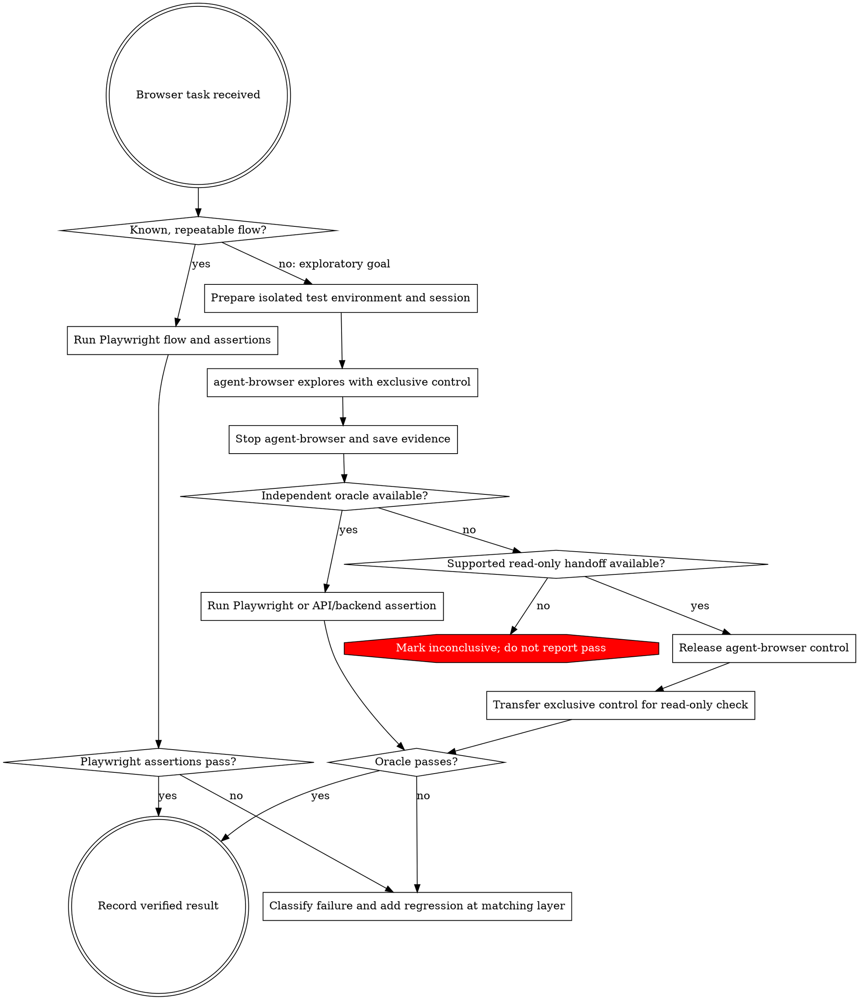

# Agent-Browser + Playwright

## Core rule

Use agent-browser to explore unfamiliar, goal-based web tasks. Use Playwright for known, repeatable flows and as an independent oracle for exploratory results. Give a browser context one active controller at a time. An agent's completion message is not proof that the expected state was reached.

## Capabilities

| Surface | Useful capabilities | Best fit |
| --- | --- | --- |
| agent-browser CLI | Agent-directed browser CLI; accessibility snapshots with element refs; navigation, clicks, form input, keyboard actions and waits; text/value/attribute getters; dialogs and files; screenshots, tabs, console and network inspection; request routing/mocking and HAR export; named sessions with separate browser state. Interactive or delta snapshots, output caps, and unchanged-screenshot suppression can reduce returned context. | Discover an unfamiliar route, inspect changing page state, and gather evidence while one controller owns the session. |
| Playwright library / Test | Code-first locators by role, label, text or test id; actions that auto-wait for actionability; retrying web assertions; isolated browser contexts; test-runner fixtures, projects and reports; API/network mocking; traces with DOM snapshots, screenshots, network and console details. | Execute a specified flow repeatedly, assert its postconditions, and keep a deterministic UI regression. |
| Playwright MCP | Tool-by-tool navigation, accessibility snapshots and search, element actions, forms, keyboard input, waits, tabs and isolated contexts, page-scoped evaluation, screenshots, console and network inspection. Optional capabilities can add explicit visibility/value assertions, locator generation, storage/network controls, vision, PDF, tracing and video. The exposed tools vary by MCP configuration. | Interactive inspection or verification when the required tools are enabled. Use the Playwright Test/library when you need a durable automated test suite. |

These surfaces are related but not interchangeable: Playwright MCP calls do not by themselves create a Playwright Test suite, and agent-browser's CLI calls are not Playwright assertions. Check which MCP capabilities are exposed before relying on them. Do not use `browser_run_code_unsafe` for this workflow; it executes arbitrary code in the Playwright server process.

For agent-browser, domain allowlists, action policies and output controls are opt-in. Confirm the effective settings for the session before navigation. Its domain allowlist constrains browser requests but is not an operating-system or container egress firewall.

## Official references

- agent-browser: [commands](https://agent-browser.dev/commands), [security](https://agent-browser.dev/security), [sessions](https://agent-browser.dev/sessions), [snapshots](https://agent-browser.dev/snapshots), [network](https://agent-browser.dev/network).
- Playwright: [locators](https://playwright.dev/docs/locators), [actionability and auto-waiting](https://playwright.dev/docs/actionability), [test assertions](https://playwright.dev/docs/test-assertions), [browser contexts](https://playwright.dev/docs/browser-contexts), [trace viewer](https://playwright.dev/docs/trace-viewer).
- Playwright MCP: [capabilities](https://playwright.dev/mcp/capabilities), [tabs](https://playwright.dev/mcp/tools/tabs), [testing and assertions](https://playwright.dev/mcp/tools/assertions), [tracing](https://playwright.dev/mcp/tools/tracing).

## Route the task

| Task | Driver | Check |
| --- | --- | --- |
| Known flow with a fixed specification | Playwright only | Its declared assertions |
| Unfamiliar goal or discoverability question | agent-browser | Independent Playwright or API/backend assertion after exploration stops |
| Outcome exists only in the current page | agent-browser, then a supported sequential handoff | Read-only check after agent-browser releases control |

## Run the exploratory lane

1. Define the observable postcondition before exploration and use staging or disposable test data. Before opening the app, verify that the effective agent-browser session enforces the intended target-domain and action restrictions; these controls are opt-in by default. If either restriction cannot be verified, stop and report exploration as not run / unverified.
2. Confirm `agent-browser` is available. Before first use or after a CLI version change, read its version-matched instructions with `agent-browser skills get core`. If the CLI is unavailable, report the combined run as not run / unverified and ask whether to install it or switch to a clearly labeled Playwright-only flow; do not install it without authorization.
3. Let agent-browser own its session until the goal attempt ends. Do not issue Playwright actions against that same context concurrently.
4. At the end of the attempt, stop state-changing exploration. Record the goal, app/build, final URL, completion status, relevant snapshot or screenshot, and errors; redact secrets and sensitive user data from snapshots, logs, screenshots, and network/HAR details. Then explicitly release agent-browser's exclusive control before another browser tool acts.
5. Prefer an independent Playwright assertion in a fresh context or an API/backend oracle. If only the current page exposes the outcome, use a sequential, read-only Playwright handoff only after agent-browser has explicitly released control and only if the harness supports a handoff that preserves the page. Otherwise report **inconclusive**.
6. Pass only when the declared oracle succeeds. If no oracle or supported handoff can observe the outcome, report **inconclusive**. Classify failures by the broken contract and add a deterministic regression at the lowest layer that still covers it: Playwright for UI behavior, API/hosted tests for service contracts, or artifact checks for generated files.

## Common mistakes

- Running both tools against one browser context at the same time.
- Treating the agent's `completed` status, a screenshot, or a model summary as the pass condition.
- Passing a hidden, mutable browser session between stages instead of recording inspectable evidence.
- Turning every exploratory failure into a UI test when the broken contract belongs at the API or artifact layer.
